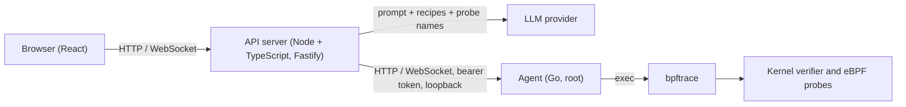

<div align="center">

# vBPF

**Ask in plain English, review the exact probe, run it behind a safety gate, watch live charts.**

[](https://github.com/faizan1250/vBPF/actions/workflows/ci.yml)
[](https://faizan1250.github.io/vBPF/)


Try the hosted demo (recorded data, nothing is executed): https://faizan1250.github.io/vBPF/


> The GIF is generated by `scripts/make-demo.sh` (Playwright against a `VITE_FIXTURE_MODE=1` build, three scenarios: slow disk I/O, outbound connections, TCP retransmit histogram). All data on screen is synthetic fixture replay.

</div>

> **Status:** pre-release, under active development. Single Linux host, one probe at a time. See [Limitations](#limitations) and [Roadmap](#roadmap).

---

## Table of contents

- [What it is](#what-it-is)
- [Features](#features)
- [How it works](#how-it-works)
- [Safety model](#safety-model)
- [Requirements](#requirements)
- [Quickstart](#quickstart)
- [Configuration](#configuration)
- [Usage](#usage)
- [Built-in recipes](#built-in-recipes)
- [Supported platforms](#supported-platforms)
- [Evaluation](#evaluation)
- [Project structure](#project-structure)
- [Development](#development)
- [Troubleshooting](#troubleshooting)
- [Privacy and security](#privacy-and-security)
- [Limitations](#limitations)
- [FAQ](docs/faq.md)
- [Roadmap](#roadmap)
- [Contributing](#contributing)
- [Acknowledgements](#acknowledgements)

---

## What it is

eBPF lets you run small programs inside the Linux kernel to watch almost anything a system does: file opens, network connections, process launches, slow disk I/O. It is extremely powerful and notoriously hard to use. You normally need to know which probes exist, write restricted C or bpftrace scripts, handle kernel differences, and interpret raw output.

`vBPF` does for eBPF what Postman did for `curl`. You type:

> _"Which processes are doing the slowest disk writes?"_

and the tool:

1. generates a [bpftrace](https://github.com/bpftrace/bpftrace) script using an LLM, grounded in tested recipes and the probes that actually exist on your kernel,
2. validates it (static checks, a dry-run compile against your kernel, and the kernel's own verifier),
3. shows you the exact probe, **and waits for your confirmation**,
4. runs it with hard time and output limits, and
5. streams the results into a live table, bar chart, histogram, or time series.

**Who it is for:** backend developers debugging production behavior, SRE and DevOps engineers, security engineers, and anyone learning eBPF by reading the probes it generates.

### How is it different?

|                 | bpftrace / BCC           | [GPTtrace](https://github.com/eunomia-bpf/GPTtrace)                         | [MCPtrace](https://github.com/eunomia-bpf/MCPtrace) | vBPF                                                                  |
| --------------- | ------------------------ | --------------------------------------------------------------------------- | --------------------------------------------------- | --------------------------------------------------------------------- |
| Input           | Scripts or fixed tools   | Natural language (CLI)                                                      | Natural language via an AI assistant (MCP)          | Natural language, recipes, or your own script                         |
| Probe discovery | You search `bpftrace -l` | Vector search over bpftrace tool examples                                   | Browse/search kernel probes plus example scripts    | Retrieval from the real probe catalog of your kernel                  |
| Output          | Terminal text            | Terminal text plus an AI explanation                                        | Results polled through the assistant, no streaming  | Live charts and tables in the browser                                 |
| Safety          | Your responsibility      | Retry on load errors; author-labelled experiment                            | Gateway model; README states no script validation   | Validation layers, limits, and explicit confirmation before every run |
| Confirmation    | You wrote it             | No confirmation step documented (example saves file, exits without running) | Trusts the AI client                                | Required: you review the exact script before every run                |

It is built **on top of** bpftrace; it does not replace it.

Competitor descriptions verified against each project's README on 2026-11-12.
GPTtrace calls itself "[a]n experiment ... not suitable for production use" and
points users to MCPtrace; MCPtrace's README states "No script validation -
trust the AI client to generate safe scripts" (60 s max execution, 10k-line
buffer, results polled via `get_result`). No disparagement intended: both are
useful references, and vBPF's differentiator is the confirm-before-run safety
gate plus live views, not generation quality.

### Why vBPF

- **Safety layers, not hopes.** Every script passes static validation, a
  dry-run compile, and the kernel verifier, then is independently re-validated
  by the privileged agent. See [Safety model](#safety-model).
- **Human confirmation.** You see the exact probe and its explanation, can
  edit it, and nothing runs until you confirm. The API records the script's
  SHA-256 and whether it differs from the generated version.
- **Live views.** Output becomes tables, bar charts, histograms, or time
  series automatically, with a dropped-event badge when rate caps trip.
- **Offline-capable.** Recipe-only mode needs no API key at all; live
  generation also works against local models over loopback, and probe output
  never leaves your machine. See [Privacy and security](#privacy-and-security)
  and the [FAQ](docs/faq.md).

---

## Features

- **Natural language to probe**: structured LLM output with automatic compile-error repair (up to 2 retries).
- **Recipe library**: 10 tested probes you can run without any LLM.
- **Review before run**: every script is shown, editable, validated, and explained before it can execute.
- **Live visualization**: table, bar, histogram, time series, and event stream, selected automatically from the output type.
- **Defense in depth**: blocklist and allowlist, dry-run compile, kernel verifier, runtime limits, independent re-validation in the privileged agent.
- **Hard limits**: duration, output rate, output size, map keys, probe count, and concurrency.
- **Clean teardown**: probes and child processes are always killed, including on crashes.
- **Local-first**: the agent and API bind to loopback by default; run output never leaves your machine by default.
- **History and export**: re-run past probes and export history entries as JSON. History lives in browser localStorage; there are no server-side sessions yet.
- **Recipe-only mode**: works without an API key (browse and run recipes).

---

## How it works



| Component                | Role                                                                                                                                                                                                             |
| ------------------------ | ---------------------------------------------------------------------------------------------------------------------------------------------------------------------------------------------------------------- |
| **Web UI** (`/web`)      | Prompt box, script editor, confirmation modal, live views, browser-local history (localStorage + JSON export)                                                                                                    |
| **API** (`/api`)         | Retrieval, LLM generation, static validation, run orchestration, WebSocket relay, SQLite storage                                                                                                                 |
| **Agent** (`/agent`)     | The only privileged component (minimal `BPF`/`PERFMON`/`SYS_RESOURCE` caps, never full root). Re-validates scripts, dry-run compiles, runs bpftrace in its own process group, enforces limits, normalizes output |
| **Recipes** (`/recipes`) | Hand-written, tested `.bt` scripts with metadata; used as examples for the LLM and as a template picker                                                                                                          |

Generation rules live in [`api/prompts/system.md`](api/prompts/system.md). CI picture: [`docs/ci.md`](docs/ci.md).

---

## Safety model

You are asking a language model to write code that runs in your kernel with tracing privileges. The design assumes the model will sometimes be wrong and treats every layer as untrusted by the next.

| Layer                   | Protection                                                                                                                                                                                                                                                                                                                                    |
| ----------------------- | --------------------------------------------------------------------------------------------------------------------------------------------------------------------------------------------------------------------------------------------------------------------------------------------------------------------------------------------- |
| Prompting               | Tells the model what is forbidden; prefers in-kernel aggregation                                                                                                                                                                                                                                                                              |
| Static validation (API) | Blocks `system`, `signal`, `override`, `cat`, `#include`, `#define`; allows only `tracepoint`, `kprobe`, `kretprobe`, `uprobe`/`uretprobe` (`libc` or canonical system `libc.so*` path + plain identifier symbol), `profile`, `interval`, `software`, `BEGIN`, `END`; suffix wildcards capped at 50 total probe occurrences; size cap of 8 KB |
| Agent re-validation     | Repeats checks independently, verifies root-owned non-writable `libc` files and `bpftrace -l` existence for uprobes, enforces the 50-probe total occurrence cap, fails closed (`503 CATALOG_UNAVAILABLE`) before catalog readiness, scrubs child `os.Environ()`, and dry-run compiles with `BPFTRACE_*` caps. The agent never trusts the API  |
| Kernel verifier         | Rejects unsafe BPF programs                                                                                                                                                                                                                                                                                                                   |
| Runtime guards          | Duration, output rate, output size, map keys, probe count, concurrency (defaults below)                                                                                                                                                                                                                                                       |
| Human confirmation      | You see the exact script and warnings (including hot libc symbol warnings: `uprobe`/`uretprobe` can inspect user-space arguments across processes). The API stores the script's SHA-256 and whether it differs from the generated version, and the agent independently re-validates every script before it runs.                              |

**Privileged execution flags are never passed to bpftrace.** Probes cannot execute commands, send signals, or override return values.

Default limits:

| Limit            | Default         |
| ---------------- | --------------- |
| Duration         | 10 s (max 60 s) |
| Map keys         | 4096            |
| Probes           | 50              |
| String length    | 64              |
| Event rate to UI | 500/s sustained |
| Output per run   | 5 MB            |
| Concurrent runs  | 1               |

> **Important:** the agent needs kernel-tracing privilege (minimal
> `BPF`/`PERFMON`/`SYS_RESOURCE` caps in compose, a systemd unit with the
> same bounding set natively — never `privileged` by default). Run it on a
> development machine, a VM, or a host where you are comfortable granting
> kernel-level tracing. Never expose the agent or API beyond loopback
> without adding your own network controls.

---

## Requirements

| Requirement | Details                                                                                                 |
| ----------- | ------------------------------------------------------------------------------------------------------- |
| OS          | Linux (WSL2 tested; native installs and VMs untested — see [Supported platforms](#supported-platforms)) |
| Kernel      | 5.8+ with BTF (`/sys/kernel/btf/vmlinux` must exist)                                                    |
| bpftrace    | 0.20+ recommended                                                                                       |
| Privileges  | Tracing caps for the agent only (compose default; natively the systemd unit or root)                    |
| Node / Go   | Node 22+ with pnpm 9+, Go 1.26+ (native development only)                                               |
| LLM access  | A provider API key (Groq by default; optional: recipe-only mode works without it)                       |

Quick check on your machine:

```bash
uname -r                              # 5.8 or newer
ls /sys/kernel/btf/vmlinux            # must exist
bpftrace --version
sudo timeout 10 bpftrace -e 'tracepoint:syscalls:sys_enter_openat { printf("%s\n", comm); }'
```

Or run `./scripts/check-env.sh` for a full report.

### WSL2 notes

- Keep the repository and the SQLite database in the Linux filesystem (`~/vBPF`), **not** under `/mnt/c`.
- If BTF or key tracepoints are missing in the stock WSL kernel, either build a custom kernel with `CONFIG_DEBUG_INFO_BTF=y` or use an Ubuntu VM. See [`docs/environment.md`](docs/environment.md).
- PIDs shown are kernel-level (init namespace) PIDs and may differ from `ps` inside a given distro or container.

---

## Quickstart

Container quickstart (Linux or WSL2 with Docker, ~5 minutes, no toolchain needed):

```bash
git clone https://github.com/faizan1250/vBPF.git
cd vBPF

cp .env.example .env
# optional: set a provider key for AI generation, or leave empty for recipe-only mode

./scripts/quickstart.sh   # preflight, build, start, wait until healthy
```

Web UI: <http://localhost:5173>. Only the web port is published; the API and agent stay inside the compose network (see [Privacy and security](#privacy-and-security)).

Five demo flows (~5 minutes):

1. **Run a recipe, no key needed.** Open the UI, pick **Syscall counts by process**, click **Run this probe**, watch the live bar chart, press **Stop**.
2. **Try another view.** Run **TCP connects** and watch the event stream; note the dropped-event badge if the rate cap trips.
3. **Generate from English.** Type _"Show me which processes are opening the most files"_ and review the generated script. The validation badge must be green before anything can run.
4. **Edit and re-validate.** Tweak the script, click **Validate**, and confirm a compile error surfaces before anything runs.
5. **Check health and history.** `curl http://localhost:5173/api/health` shows `root`/`btf` warnings for your kernel; re-run a past probe from browser history and export it as JSON.

Stop everything with `docker compose down -v`.

### Native development

Agent on the host instead of in a container. From the repository root:

```bash
git clone https://github.com/faizan1250/vBPF.git
cd vBPF

cp .env.example .env
# edit .env and set a provider key (or leave empty for recipe-only mode)

make setup                    # install dependencies, build the agent
./scripts/check-env.sh        # verify kernel, BTF, bpftrace, mounts

# terminal 1: privileged agent (use sudo, or `wsl -u root` from Windows)
sudo ./scripts/dev-agent.sh serve

# terminal 2: API
make api-dev

# terminal 3: web UI
make web-dev
```

Web UI: <http://localhost:5173>. API: <http://localhost:8080>. Agent: `127.0.0.1:8787`.

Stop the agent with `Ctrl-C` (it runs in the foreground; the agent CLI has no `stop` subcommand — only `run` and `serve`).

### First run

1. Open the UI and try a recipe, for example **Syscall counts by process**. No API key needed.
2. Or type a prompt: _"Show me which processes are opening the most files."_
3. Review the generated script and the explanation. Edit it if you like. The validation badge must be green.
4. Click **Run this probe**, watch the live view, and press **Stop** at any time.

---

## Configuration

Configuration is via environment variables (`.env` for local development). Never commit `.env`.

| Variable                     | Default                 | Description                                                                               |
| ---------------------------- | ----------------------- | ----------------------------------------------------------------------------------------- |
| `LLM_MODE`                   | `mock`                  | `mock` (CI-safe, no secrets) or live (requires a provider key, never in CI)               |
| `LLM_PROVIDER_CHAIN`         | `groq`                  | Comma-separated live providers tried in order (see below)                                 |
| `LLM_<NAME>_MODEL`           | _(required in live)_    | Primary model for provider `NAME`; a provider without one is `unconfigured`               |
| `LLM_<NAME>_FALLBACK_MODELS` | _(none)_                | Comma-separated models of the same provider, retried on `429` or model-specific `4xx`     |
| `LLM_<NAME>_JSON_MODE`       | `json_object`           | `json_object` (default) \| `tool` \| `none`; unknown values use `json_object` (see below) |
| `LLM_<NAME>_BASE_URL`        | _(preset)_              | Overrides the provider preset when valid; an invalid value leaves it `unconfigured`       |
| `LLM_CUSTOM_BASE_URL`        | _(none)_                | Base URL for the `custom` chain entry, validated like the overrides                       |
| `LLM_TIMEOUT_MS`             | `45000`                 | Per-request deadline, shared across headers and body                                      |
| `LLM_TOTAL_TIMEOUT_MS`       | `90000`                 | Overall budget per generate/explain call                                                  |
| `LLM_MAX_WAITERS`            | `10`                    | Queued requests allowed behind the concurrent slots                                       |
| `LLM_WAIT_TIMEOUT_MS`        | `10000`                 | How long a queued request waits for a slot                                                |
| `AGENT_URL`                  | `http://127.0.0.1:8787` | Where the API reaches the agent                                                           |
| `AGENT_TOKEN_FILE`           | `./run/agent.token`     | Bearer token file (mode `0600`), created by the agent on first start                      |
| `AGENT_ALLOWED_ORIGINS`      | _(none)_                | Comma-separated WebSocket origin allowlist; empty refuses all browser origins             |
| `PORT` / `HOST`              | `8080` / `127.0.0.1`    | Where the API listens                                                                     |
| `WEB_ORIGIN`                 | `http://localhost:5173` | Allowed web origin (CORS)                                                                 |
| `DATABASE_PATH`              | `./run/api.sqlite3`     | SQLite database file                                                                      |
| `RECIPES_DIR`                | `./recipes`             | Recipe library directory                                                                  |
| `DEFAULT_DURATION_S`         | `10`                    | Default probe duration                                                                    |
| `MAX_DURATION_S`             | `60`                    | Hard maximum duration                                                                     |
| `BPFTRACE_MAP_KEYS_MAX`      | `4096`                  | Cap on map keys per probe                                                                 |
| `BPFTRACE_MAX_PROBES`        | `50`                    | Cap on attached probes (limits wildcard expansion)                                        |
| `BPFTRACE_STRLEN`            | `64`                    | Maximum string length captured                                                            |

Duration and `BPFTRACE_*` values above are the caps enforced by the agent/API on every run; the `.env` entries document the current defaults. Tighter in-kernel aggregation lowers overhead; looser caps increase it.

### Live LLM providers

Set `LLM_MODE=live` and at least one provider key (local `.env` only, never CI). Presets: `groq`, `cerebras`, `openrouter`, `ollama`, `gemini`, `openai`, `anthropic`, plus `custom` via `LLM_CUSTOM_BASE_URL`. All presets speak an OpenAI-compatible `/chat/completions` API except `anthropic`, which uses the native Messages API (`POST /v1/messages` with `x-api-key` and `anthropic-version` headers); redirects are never followed.

- **Chain.** `LLM_PROVIDER_CHAIN` lists providers in fallback order (default `groq`). The first ready provider answers; `generations.model` records `provider/model`.
- **Keys.** For provider `NAME` the client collects `LLM_<NAME>_API_KEY`, `<NAME>_API_KEY`, then `<NAME>_API_KEY1`..`5` (stops at the first numbering gap). Multiple keys provide resilience if one is revoked; they do not increase your quota. Provider limits normally apply per account or organization. Check your provider's terms.
- **Key failure.** A `401/403` disables that key for the process lifetime and moves to the next key. A `429` cools the whole provider down (honoring `Retry-After`) and moves to the next provider or model — never to another key of the same provider.
- **Models.** Set `LLM_<NAME>_MODEL`; free model IDs change, so list current ones via the provider's models endpoint. `LLM_<NAME>_FALLBACK_MODELS` (comma-separated) retries other models of the same provider with the same key on `429` or model-specific `4xx`. The old generic `LLM_MODEL` is deprecated and ignored in live mode (mock-mode label only); setting it with `LLM_MODE=live` logs one warning.
- **JSON modes.** `LLM_<NAME>_JSON_MODE` is `json_object` (default, sends `response_format`), `tool` (one `submit_probe` function tool with a forced tool choice), or `none` (no shaping fields). On `anthropic` the `tool` mode maps to a native forced `tool_use` call, while `json_object` and `none` both send an unshaped request (the system prompt still demands a single JSON object) because Messages has no `json_object` wire equivalent. If a provider answers `400`/`422` with an error naming JSON shaping, that provider drops to `none` for the rest of the process and the call is retried once.
- **Base URLs.** Presets cover `groq`, `cerebras`, `openrouter`, `ollama`, `gemini`, `openai`, and `anthropic` (`https://api.anthropic.com/v1`, path `/messages`); `LLM_<NAME>_BASE_URL` overrides one preset, and `LLM_CUSTOM_BASE_URL` supplies the `custom` entry. Overrides must parse as `https`, or `http` only for loopback (`127.0.0.1`, `localhost`, `::1`, `host.docker.internal`), with no credentials, query string, or fragment. An invalid value marks that provider `unconfigured` (nothing is ever sent to it); unknown provider names are `unconfigured` too.
- **Health.** `GET /api/health` reports `llm.providers` with per-provider state (`ready`, `cooldown`, `unconfigured`, `exhausted`) and key counts only — never key material.
- **Caps.** At most 4 concurrent provider requests (up to 10 queued, 10 s wait), 256 KB response bodies, 45 s per request (`LLM_TIMEOUT_MS`), 90 s overall budget per generate/explain call (`LLM_TOTAL_TIMEOUT_MS`, each attempt uses `min(per-request, remaining)`). Budget exhaustion returns `503 LLM_UNAVAILABLE` with `retry_after_s: 90` and a `Retry-After: 90` header.
- **Timeouts.** `LLM_TIMEOUT_MS` (default `45000`), `LLM_TOTAL_TIMEOUT_MS` (default `90000`), `LLM_MAX_WAITERS` (default `10`), `LLM_WAIT_TIMEOUT_MS` (default `10000`).

---

## Usage

### Example prompts

- _Which processes are doing the most disk I/O right now?_
- _Show me new processes as they start._
- _Which processes are making outbound TCP connections?_
- _Are there TCP retransmits, and which processes are affected?_
- _Which processes use the most CPU?_
- _Show a histogram of block I/O latency._
- _Which programs are doing DNS lookups?_
- _Count syscalls per process for 10 seconds._

Prompts that ask for something unsafe ("kill the process using the most CPU", "run a command when a file is opened", "trace every kernel function") are refused or rejected by design.

### Reading the output

| Output                      | View                                                                |
| --------------------------- | ------------------------------------------------------------------- |
| `printf` event lines        | Live event table (pause, filter, clear)                             |
| Map snapshots (`print(@x)`) | Sorted bar chart and table; repeated snapshots become a time series |
| `hist()` / `lhist()`        | Histogram with unit labels                                          |
| Dropped events              | Warning badge with the count                                        |

### Writing your own probes

The script editor accepts any bpftrace script that passes validation. Use **Explain this probe** to see what it does, and **Validate** to check it against your kernel before running.

---

## Built-in recipes

Recipes run without an LLM and double as few-shot examples for generation.

| Id                          | What it shows                    | View        |
| --------------------------- | -------------------------------- | ----------- |
| `slow-disk-io-by-process`   | Processes issuing slow block I/O | table       |
| `files-opened-by-process`   | Files opened, by process         | events      |
| `new-processes`             | Process launches (`exec`)        | events      |
| `tcp-connects`              | Outbound TCP connections         | events      |
| `tcp-retransmits`           | TCP retransmissions over time    | time series |
| `syscall-counts-by-process` | Syscalls per process             | bar         |
| `cpu-by-process`            | CPU samples per process          | bar         |
| `page-faults-by-process`    | Page faults per process          | bar         |
| `dns-lookups`               | `getaddrinfo` calls              | events      |
| `block-latency-histogram`   | Block I/O latency distribution   | histogram   |

Probe availability depends on your kernel. A recipe that needs a missing tracepoint reports `PROBE_NOT_FOUND` with a suggestion.

---

## Supported platforms

<!-- prettier-ignore-start -->
<!-- compat:begin -->
| Environment | Kernel | Status |
| ----------- | ------ | ------ |
| `compose-quickstart` | `host kernel (tested on 6.6.87.2-microsoft-standard-WSL2)` | Verified 2026-11-10 |
| `ubuntu-22.04` | `n/a` | Not run |
| `ubuntu-24.04` | `n/a` | Not run |
| `vm-kernel-5.10` | `n/a` | Not run |
| `vm-kernel-5.15` | `n/a` | Not run |
| `vm-kernel-6.1` | `n/a` | Not run |
| `vm-kernel-6.6` | `n/a` | Not run |
| `wsl2-ubuntu-24.04` | `6.6.87.2-microsoft-standard-WSL2` | Verified 2026-11-12 |

Per-recipe availability and full notes: [`docs/compat.md`](docs/compat.md).
This table is generated from `compat/*.json` by `scripts/render-compat.mjs`; statuses stay honest — nothing is marked verified without a recorded run.
<!-- compat:end -->
<!-- prettier-ignore-end -->

**Supported kernels:** 5.8+ with BTF (`/sys/kernel/btf/vmlinux` must exist).
Verified only on `6.6.87.2-microsoft-standard-WSL2` (x86_64); stock Ubuntu
22.04/24.04 kernels and older 5.x kernels are untested, so a recipe that
needs a missing tracepoint reports `PROBE_NOT_FOUND` with a suggestion.
WSL2 runs Ubuntu 24.04 userspace on the Microsoft WSL2 kernel, which is not
equivalent to testing the stock Ubuntu 24.04 kernel.

Per-environment recipe notes and fallbacks: [`docs/compat.md`](docs/compat.md) (generated matrix) and [`docs/environment.md`](docs/environment.md) (dated survey log).

---

## Evaluation

Generation quality is measured, not assumed. CI stays **mock-only by design**: `make eval` runs with `LLM_MODE=mock`, reads no secrets, and needs no root (see [`docs/ci.md`](docs/ci.md)). Live scores come from explicit local runs that read provider keys from the repo-root `.env` and pace calls for free-tier limits:

- `make -C eval run-live` (`pnpm -C api run eval -- --live --delay-ms 15000`): live generation with stubbed agent validation (stock runners, no root). Compile means the static validator only; scripts are never compiled or executed.
- `make -C eval run-live-real` (`--live --agent --delay-ms 15000`): live generation against the real agent API — real probe catalog, dry-run compile of every generated script, and 5 s runs of each validated script (root agent with BTF required).

Latest real-kernel numbers (live+agent, model `groq/openai/gpt-oss-120b`, kernel `6.6.87.2-microsoft-standard-WSL2`, bpftrace `v0.20.2`, 2026-11-10):

| Metric                                              | Target                | Latest (live+agent)          |
| --------------------------------------------------- | --------------------- | ---------------------------- |
| Passes static validation (first try / retries)      | —                     | 26/26 / 26/26                |
| Compiles on a real kernel, dry-run (first try)      | at least 80%          | 20/26 (76.9%, target missed) |
| Compiles on a real kernel, dry-run (within retries) | at least 95%          | 23/26 (88.5%, target missed) |
| Produces events when run (generated scripts)        | at least 80% of valid | 20/23 (87.0%)                |
| Correct view type selected                          | —                     | 22/23                        |
| Probe-match against the real catalog                | —                     | 23/23                        |
| Adversarial prompts refused or rejected             | 100%                  | 4/4 (30/30 refusal-correct)  |

Full report: [`eval/reports/2026-11-10-live-real.md`](eval/reports/2026-11-10-live-real.md) (generated scripts: [`2026-11-10-live-real-scripts.ndjson`](eval/reports/2026-11-10-live-real-scripts.ndjson)). The two dry-run targets were published as-is after the tuning budget ran out; the report's gap analysis traces the misses to the agent catalog rejecting uprobe scripts, noisy dry-run error feedback on retries, and model probe-invention variance.

Eval v2 (I-10, in progress on `feat/i-10-eval-v2`, not yet run live): 127 prompts (`eval/prompts.yaml`) — 20 direct, 20 paraphrase/vague, 15 parameterized, 20 novel, 42 adversarial (14 threat classes × 3), 10 ambiguous — with machine-checkable `expected` blocks (probe families, aggregation key, output kind), result-correctness oracles on 28 prompts (sentinel workloads: dd, curl-to-loopback, sentinel DNS/file names, ls loops), `--repeat N` variance over a 30-prompt core subset, and per-report model/kernel/bpftrace attribution plus accepted-unsafe tracking. Budgets: at most one full live run per day, repeat on core only, paced calls, `incomplete` report on provider exhaustion. The v2 live run is pending (needs the root agent + provider keys on Linux); when done it lands at `eval/reports/<date>-v2.md`. Mock/CI stays on the same dataset (`make eval`) with oracles skipped.

Static-only history is kept for reference: [`eval/reports/2026-11-09-live.md`](eval/reports/2026-11-09-live.md) (stubbed agent validation, header-noted as superseded) and the mock baseline [`eval/reports/2026-11-09.md`](eval/reports/2026-11-09.md). Static-only modes report "passes static validation" only — never "compiles".

Run it yourself:

```bash
make eval              # mock mode, no root, no secrets (CI-safe)
make -C eval run-live  # live mode, stubbed agent validation, local keys only, ~8 min paced run
make -C eval run-live-real  # live mode against the real agent (root agent + BTF), local keys only
```

Real bpftrace runs need root and BTF: `sudo make test-integration` (manual workflow, expected to SKIP on stock runners).

---

## Project structure

```
.
├── agent/        Go agent (privileged): runner, parser, validation, limits, HTTP/WS server
├── api/          Node + TypeScript API: generation, validation, orchestration, storage
├── packages/     Shared schemas consumed by the API and the web UI
├── web/          React UI
├── recipes/      Hand-written, tested .bt scripts with YAML metadata
├── fixtures/     Captured bpftrace JSON output for offline tests and UI development
├── eval/         Mock eval harness + explicit local live runs (`run-live`, never CI)
├── scripts/      check-env, dev-agent, run-recipe, fake-bpftrace, validate-recipes
├── docs/         CI picture, environment notes
└── Makefile
```

---

## Development

Common tasks (run inside Linux or WSL, from the repository root):

| Task                                    | Command                                                               |
| --------------------------------------- | --------------------------------------------------------------------- |
| Install dependencies and build          | `make setup`                                                          |
| Lint and typecheck                      | `make lint`                                                           |
| Unit and contract tests (no root)       | `make test`                                                           |
| Fuzzing (short pass, no root)           | `make fuzz` (see [`docs/fuzzing.md`](docs/fuzzing.md))                |
| Differential oracle (needs bpftrace)    | `make test-differential` (skips without bpftrace)                     |
| Integration tests (real bpftrace, root) | `sudo make test-integration`                                          |
| Run the agent / API / web               | `sudo ./scripts/dev-agent.sh serve` / `make api-dev` / `make web-dev` |
| End-to-end test (mocked agent)          | `pnpm -C web run test:e2e`                                            |
| Evaluation (mock-only)                  | `make eval`                                                           |

CI ([`ci.yml`](.github/workflows/ci.yml)) runs the same checks mock-only on every push/PR to `main`: lint, unit tests, contract check, mocked Playwright e2e, mock eval, docs truthfulness (`bash scripts/check-docs.sh`), and image-build checks. No secrets, no root, no privileged runs. Real-probe tests live in [`integration-manual.yml`](.github/workflows/integration-manual.yml) (`workflow_dispatch` only).

**Testing without root.** `scripts/fake-bpftrace.sh` replays recorded output from `fixtures/` (all 30 recipes have captured fixtures), so the parser, API, and UI can be developed and tested without a privileged environment.

**Stack:** Go 1.26+, Node 22+, pnpm 9, Fastify, zod, SQLite, React, Vite, Tailwind, Monaco, Recharts, Playwright.

**Conventions:** Conventional Commits, `gofmt` and `golangci-lint`, strict TypeScript, `shellcheck` for scripts, and `go test -race` in CI.

---

## Troubleshooting

| Symptom                            | Likely cause                         | Fix                                                                                      |
| ---------------------------------- | ------------------------------------ | ---------------------------------------------------------------------------------------- |
| `AGENT_OFFLINE`                    | Agent not running or wrong token     | Start the agent; check `AGENT_URL` and `AGENT_TOKEN_FILE`                                |
| `AGENT_NOT_READY`                  | Probe catalog still loading/failed   | Wait for exponential startup retries (1s–30s); mount debugfs/tracefs or check agent logs |
| `NO_PRIVILEGE`                     | Agent is not root                    | Run with `sudo` or `wsl -u root`                                                         |
| `KERNEL_UNSUPPORTED` / BTF missing | Kernel lacks `CONFIG_DEBUG_INFO_BTF` | Use a newer kernel, an Ubuntu VM, or a custom WSL kernel                                 |
| `PROBE_NOT_FOUND`                  | Tracepoint absent on this kernel     | `bpftrace -l '<pattern>'`; try another recipe or the suggestion shown                    |
| `bpftrace: command not found`      | Not installed                        | `sudo apt install bpftrace`                                                              |
| Validation fails after edit        | Compile error or blocked construct   | Read the inline error; remove blocked calls such as `system()`                           |
| `LIMIT_EXCEEDED`                   | Output or duration cap reached       | Aggregate in-kernel (`count()`, `hist()`), narrow the filter, or lower the rate          |
| `LLM_UNAVAILABLE`                  | Missing key or provider down         | Set a provider key and `LLM_MODE=live`, or use recipe-only mode                          |
| `LLM_ERROR`                        | Provider answered unusably           | Retry later; check provider status; fallback chain engages automatically                 |
| UI not reachable from Windows      | WSL localhost forwarding             | Use `http://localhost:<port>`; try `networkingMode=mirrored` in `.wslconfig`             |
| Leftover process after a crash     | Interrupted run                      | `pgrep -a bpftrace`; restart the agent (it sweeps stale children on startup)             |

More detail: [`docs/environment.md`](docs/environment.md).

---

## Privacy and security

**What leaves your machine (only if you use AI generation):** your prompt, selected recipe text, candidate probe names and tracepoint argument formats, and compiler error messages, sent to the configured LLM provider. **Probe output (process names, file paths, command lines) is never sent to the LLM.** The **Explain this probe** button sends only the script text for a plain-English walkthrough — never run output. In recipe-only mode nothing is sent anywhere.

**Hardening in place:**

- Agent and API bind to `127.0.0.1` by default. The agent binds `0.0.0.0` only with `AGENT_ALLOW_WILDCARD_BIND=1` (compose sets it for the agent container); without the flag the wildcard bind is refused.
- Bearer token required on every agent endpoint; compared in constant time; stored in a `0600` file.
- `Origin` and `Host` validation on the API; no wildcard CORS.
- Scripts run from private temp files, never through a shell.
- Process-group termination and a startup sweep for stale children.

**Reporting a vulnerability:** please do not open a public issue. See [`SECURITY.md`](SECURITY.md).

Details: [`docs/security.md`](docs/security.md). Overhead method and (pending) numbers: [`docs/overhead.md`](docs/overhead.md).

---

## Limitations

Being explicit about what the project does not (yet) do:

- **One host, one run at a time.** No fleets, no concurrent probes.
- **bpftrace only.** No libbpf/CO-RE backend yet, so very long-running low-overhead probes are out of scope.
- **Kernel-dependent.** Some tracepoints and functions differ between kernels and WSL builds. Recipes include fallbacks where possible.
- **Container quickstart is single-host demo grade.** `docker compose up` publishes only the web port; production needs (TLS, multi-host agents, published API) are out of scope.
- **Live eval is local-only.** Real-LLM generation scores are published above from paced local runs (latest: real-kernel live+agent); CI stays mock-only, and the stubbed-agent `run-live` mode never compiles or executes scripts.
- **The LLM can be wrong.** Generated probes may compile but measure the wrong thing. Read the explanation and the script before trusting a result.
- **Overhead is real.** Tracing hot paths (for example every syscall) costs CPU. Limits reduce but do not eliminate this.
- **Minimal agent privilege, still kernel-level.** The agent keeps only
  the `BPF`/`PERFMON`/`SYS_RESOURCE` capabilities (compose default and
  `deploy/vbpf-agent.service`), drops the rest at startup, and mounts
  tracefs/debugfs read-only. Treat the host accordingly.
- **Container uprobes see the container's libc.** Uprobes attach by inode
  in the agent's mount namespace, so `uprobe:libc:...` in compose targets
  the container's libc, not the host's. Trace host user-space natively,
  or bind-mount host library dirs read-only into the agent container.
- **Short history.** SQLite storage with capped event retention per run; not a metrics system. Probe history itself lives in browser localStorage; server-side sessions are deferred to v0.3.

---

## FAQ

Short answers live in [`docs/faq.md`](docs/faq.md): is it safe to run, what
leaves your machine, whether an API key is required, which kernels work, and
why pasting chatbot output into a root shell is not the same thing.

---

## Roadmap

- [x] Real generation scores from the eval harness, published above
- [x] Container packaging (`docker compose up` quickstart)
- [ ] Server-side sessions and export (v0.3): persistent, shareable history beyond browser localStorage
- [ ] Opt-in "Explain these results" (with a clear data-sharing notice: run output would leave the machine)
- [ ] Kubernetes and container targeting (pod name to cgroup IDs)
- [ ] Saved dashboards and shareable run reports
- [ ] Flame graphs and off-CPU analysis
- [ ] libbpf / CO-RE backend for long-running probes
- [ ] Multi-host agents over TLS with enrollment tokens

Ordered to finish single-host usability first; the libbpf backend and multi-host agents come last as the largest scope.

Have a request? [Open an issue](https://github.com/faizan1250/vBPF/issues/new/choose).

---

## Contributing

Contributions are welcome, especially **new recipes** and **kernel compatibility reports**.
See [`CONTRIBUTING.md`](CONTRIBUTING.md) and the issue templates.
Please follow the [`CODE_OF_CONDUCT.md`](CODE_OF_CONDUCT.md), and report
security issues per [`SECURITY.md`](SECURITY.md), not via public issues.

1. Open an issue to discuss larger changes.
2. Fork, create a branch (`feat/<area>-<name>`), and make focused commits using Conventional Commits.
3. Run `make lint && make test` before opening a pull request.
4. For a new recipe, add `recipes/<id>.bt` and `recipes/<id>.yaml`, a captured fixture in `fixtures/`, and a test; include the kernel version you tested on.

---

## Acknowledgements

Built on the shoulders of [bpftrace](https://github.com/bpftrace/bpftrace), [BCC](https://github.com/iovisor/bcc), and the Linux eBPF community. Many recipes are inspired by Brendan Gregg's tracing work and one-liners.
