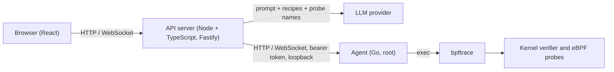

<div align="center">

# vBPF

**Describe what you want to observe in plain English. Get a safe, reviewable eBPF probe and a live visualization.**

[](https://github.com/faizan1250/vBPF/actions/workflows/ci.yml)


<!-- TODO: add a 60-90 second demo GIF or video: prompt -> probe review -> run -> live chart -->

</div>

> **Status:** pre-release, under active development. Single Linux host, one probe at a time. See [Limitations](#limitations) and [Roadmap](#roadmap).

---

## Table of contents

- [What it is](#what-it-is)
- [Features](#features)
- [How it works](#how-it-works)
- [Safety model](#safety-model)
- [Requirements](#requirements)
- [Quickstart](#quickstart)
- [Configuration](#configuration)
- [Usage](#usage)
- [Built-in recipes](#built-in-recipes)
- [Supported platforms](#supported-platforms)
- [Evaluation](#evaluation)
- [Project structure](#project-structure)
- [Development](#development)
- [Troubleshooting](#troubleshooting)
- [Privacy and security](#privacy-and-security)
- [Limitations](#limitations)
- [Roadmap](#roadmap)
- [Contributing](#contributing)
- [Acknowledgements](#acknowledgements)

---

## What it is

eBPF lets you run small programs inside the Linux kernel to watch almost anything a system does: file opens, network connections, process launches, slow disk I/O. It is extremely powerful and notoriously hard to use. You normally need to know which probes exist, write restricted C or bpftrace scripts, handle kernel differences, and interpret raw output.

`vBPF` does for eBPF what Postman did for `curl`. You type:

> _"Which processes are doing the slowest disk writes?"_

and the tool:

1. generates a [bpftrace](https://github.com/bpftrace/bpftrace) script using an LLM, grounded in tested recipes and the probes that actually exist on your kernel,
2. validates it (static checks, a dry-run compile against your kernel, and the kernel's own verifier),
3. shows you the exact probe, **and waits for your confirmation**,
4. runs it with hard time and output limits, and
5. streams the results into a live table, bar chart, histogram, or time series.

**Who it is for:** backend developers debugging production behavior, SRE and DevOps engineers, security engineers, and anyone learning eBPF by reading the probes it generates.

### How is it different?

|                 | bpftrace / BCC           | vBPF                                                                  |
| --------------- | ------------------------ | --------------------------------------------------------------------- |
| Input           | Scripts or fixed tools   | Natural language, recipes, or your own script                         |
| Probe discovery | You search `bpftrace -l` | Retrieval from the real probe catalog of your kernel                  |
| Output          | Terminal text            | Live charts and tables in the browser                                 |
| Safety          | Your responsibility      | Validation layers, limits, and explicit confirmation before every run |
| Learning curve  | Steep                    | Read the generated script and the plain-English explanation           |

It is built **on top of** bpftrace; it does not replace it.

---

## Features

- **Natural language to probe**: structured LLM output with automatic compile-error repair (up to 2 retries).
- **Recipe library**: 10 tested probes you can run without any LLM.
- **Review before run**: every script is shown, editable, validated, and explained before it can execute.
- **Live visualization**: table, bar, histogram, time series, and event stream, selected automatically from the output type.
- **Defense in depth**: blocklist and allowlist, dry-run compile, kernel verifier, runtime limits, independent re-validation in the privileged agent.
- **Hard limits**: duration, output rate, output size, map keys, probe count, and concurrency.
- **Clean teardown**: probes and child processes are always killed, including on crashes.
- **Local-first**: the agent and API bind to loopback; run output never leaves your machine by default.
- **History and export**: re-run past probes and export history entries as JSON. History lives in browser localStorage; there are no server-side sessions yet.
- **Recipe-only mode**: works without an API key (browse and run recipes).

---

## How it works



| Component                | Role                                                                                                                                              |
| ------------------------ | ------------------------------------------------------------------------------------------------------------------------------------------------- |
| **Web UI** (`/web`)      | Prompt box, script editor, confirmation modal, live views, browser-local history (localStorage + JSON export)                                     |
| **API** (`/api`)         | Retrieval, LLM generation, static validation, run orchestration, WebSocket relay, SQLite storage                                                  |
| **Agent** (`/agent`)     | The only privileged component. Re-validates scripts, dry-run compiles, runs bpftrace in its own process group, enforces limits, normalizes output |
| **Recipes** (`/recipes`) | Hand-written, tested `.bt` scripts with metadata; used as examples for the LLM and as a template picker                                           |

Generation rules live in [`api/prompts/system.md`](api/prompts/system.md). CI picture: [`docs/ci.md`](docs/ci.md).

---

## Safety model

You are asking a language model to write code that runs in your kernel with root privileges. The design assumes the model will sometimes be wrong and treats every layer as untrusted by the next.

| Layer                   | Protection                                                                                                                                                                                                                               |
| ----------------------- | ---------------------------------------------------------------------------------------------------------------------------------------------------------------------------------------------------------------------------------------- |
| Prompting               | Tells the model what is forbidden; prefers in-kernel aggregation                                                                                                                                                                         |
| Static validation (API) | Blocks `system`, `signal`, `override`, `cat`, `#include`, `#define`; allows only `tracepoint`, `kprobe`, `kretprobe`, `uprobe`/`uretprobe` (libc or absolute paths), `profile`, `interval`, `software`, `BEGIN`, `END`; size cap of 8 KB |
| Agent re-validation     | Repeats the checks independently and dry-run compiles against your actual kernel. The agent never trusts the API                                                                                                                         |
| Kernel verifier         | Rejects unsafe BPF programs                                                                                                                                                                                                              |
| Runtime guards          | Duration, output rate, output size, map keys, probe count, concurrency (defaults below)                                                                                                                                                  |
| Human confirmation      | You see the exact script. The script that runs is the one you confirmed (hash-checked)                                                                                                                                                   |

**Privileged execution flags are never passed to bpftrace.** Probes cannot execute commands, send signals, or override return values.

Default limits:

| Limit            | Default         |
| ---------------- | --------------- |
| Duration         | 10 s (max 60 s) |
| Map keys         | 4096            |
| Probes           | 50              |
| String length    | 64              |
| Event rate to UI | 500/s sustained |
| Output per run   | 5 MB            |
| Concurrent runs  | 1               |

> **Important:** the agent runs as root. Run it on a development machine, a VM, or a host where you are comfortable granting root-level tracing. Never expose the agent or API beyond loopback without adding your own network controls.

---

## Requirements

| Requirement | Details                                                                                                 |
| ----------- | ------------------------------------------------------------------------------------------------------- |
| OS          | Linux (WSL2 tested; native installs and VMs untested — see [Supported platforms](#supported-platforms)) |
| Kernel      | 5.8+ with BTF (`/sys/kernel/btf/vmlinux` must exist)                                                    |
| bpftrace    | 0.20+ recommended                                                                                       |
| Privileges  | Root for the agent only                                                                                 |
| Node / Go   | Node 22+ with pnpm 9+, Go 1.23+ (native development only)                                               |
| LLM access  | A provider API key (Groq by default; optional: recipe-only mode works without it)                       |

Quick check on your machine:

```bash
uname -r                              # 5.8 or newer
ls /sys/kernel/btf/vmlinux            # must exist
bpftrace --version
sudo timeout 10 bpftrace -e 'tracepoint:syscalls:sys_enter_openat { printf("%s\n", comm); }'
```

Or run `./scripts/check-env.sh` for a full report.

### WSL2 notes

- Keep the repository and the SQLite database in the Linux filesystem (`~/vBPF`), **not** under `/mnt/c`.
- If BTF or key tracepoints are missing in the stock WSL kernel, either build a custom kernel with `CONFIG_DEBUG_INFO_BTF=y` or use an Ubuntu VM. See [`docs/environment.md`](docs/environment.md).
- PIDs shown are kernel-level (init namespace) PIDs and may differ from `ps` inside a given distro or container.

---

## Quickstart

Container quickstart (Linux or WSL2 with Docker, ~5 minutes, no toolchain needed):

```bash
git clone https://github.com/faizan1250/vBPF.git
cd vBPF

cp .env.example .env
# optional: set a provider key for AI generation, or leave empty for recipe-only mode

./scripts/quickstart.sh   # preflight, build, start, wait until healthy
```

Web UI: <http://localhost:5173>. Only the web port is published; the API and agent stay inside the compose network (see [Privacy and security](#privacy-and-security)).

Five demo flows (~5 minutes):

1. **Run a recipe, no key needed.** Open the UI, pick **Syscall counts by process**, click **Run this probe**, watch the live bar chart, press **Stop**.
2. **Try another view.** Run **TCP connects** and watch the event stream; note the dropped-event badge if the rate cap trips.
3. **Generate from English.** Type _"Show me which processes are opening the most files"_ and review the generated script. The validation badge must be green before anything can run.
4. **Edit and re-validate.** Tweak the script, click **Validate**, and confirm a compile error surfaces before anything runs.
5. **Check health and history.** `curl http://localhost:5173/api/health` shows `root`/`btf` warnings for your kernel; re-run a past probe from browser history and export it as JSON.

Stop everything with `docker compose down -v`.

### Native development

Agent on the host instead of in a container. From the repository root:

```bash
git clone https://github.com/faizan1250/vBPF.git
cd vBPF

cp .env.example .env
# edit .env and set a provider key (or leave empty for recipe-only mode)

make setup                    # install dependencies, build the agent
./scripts/check-env.sh        # verify kernel, BTF, bpftrace, mounts

# terminal 1: privileged agent (use sudo, or `wsl -u root` from Windows)
sudo ./scripts/dev-agent.sh start

# terminal 2: API
make api-dev

# terminal 3: web UI
make web-dev
```

Web UI: <http://localhost:5173>. API: <http://localhost:8080>. Agent: `127.0.0.1:8787`.

Stop the agent with `./scripts/dev-agent.sh stop`.

### First run

1. Open the UI and try a recipe, for example **Syscall counts by process**. No API key needed.
2. Or type a prompt: _"Show me which processes are opening the most files."_
3. Review the generated script and the explanation. Edit it if you like. The validation badge must be green.
4. Click **Run this probe**, watch the live view, and press **Stop** at any time.

---

## Configuration

Configuration is via environment variables (`.env` for local development). Never commit `.env`.

| Variable                | Default                 | Description                                                                   |
| ----------------------- | ----------------------- | ----------------------------------------------------------------------------- |
| `LLM_MODEL`             | `claude-sonnet-5-5`     | Default model; per-provider `LLM_<NAME>_MODEL` takes precedence               |
| `LLM_MODE`              | `mock`                  | `mock` (CI-safe, no secrets) or live (requires a provider key, never in CI)   |
| `LLM_PROVIDER_CHAIN`    | `groq`                  | Comma-separated live providers tried in order (see below)                     |
| `AGENT_URL`             | `http://127.0.0.1:8787` | Where the API reaches the agent                                               |
| `AGENT_TOKEN_FILE`      | `./run/agent.token`     | Bearer token file (mode `0600`), created by the agent on first start          |
| `AGENT_ALLOWED_ORIGINS` | _(none)_                | Comma-separated WebSocket origin allowlist; empty refuses all browser origins |
| `PORT` / `HOST`         | `8080` / `127.0.0.1`    | Where the API listens                                                         |
| `WEB_ORIGIN`            | `http://localhost:5173` | Allowed web origin (CORS)                                                     |
| `DATABASE_PATH`         | `./run/api.sqlite3`     | SQLite database file                                                          |
| `RECIPES_DIR`           | `./recipes`             | Recipe library directory                                                      |
| `DEFAULT_DURATION_S`    | `10`                    | Default probe duration                                                        |
| `MAX_DURATION_S`        | `60`                    | Hard maximum duration                                                         |
| `BPFTRACE_MAP_KEYS_MAX` | `4096`                  | Cap on map keys per probe                                                     |
| `BPFTRACE_MAX_PROBES`   | `50`                    | Cap on attached probes (limits wildcard expansion)                            |
| `BPFTRACE_STRLEN`       | `64`                    | Maximum string length captured                                                |

Limits can be lowered freely; raising them increases overhead and risk.

### Live LLM providers

Set `LLM_MODE=live` and at least one provider key (local `.env` only, never CI). Presets: `groq`, `cerebras`, `openrouter`, `ollama`, `gemini`, plus `custom` via `LLM_CUSTOM_BASE_URL`. All speak an OpenAI-compatible `/chat/completions` API; redirects are never followed.

- **Chain.** `LLM_PROVIDER_CHAIN` lists providers in fallback order (default `groq`). The first ready provider answers; `generations.model` records `provider/model`.
- **Keys.** For provider `NAME` the client collects `LLM_<NAME>_API_KEY`, `<NAME>_API_KEY`, then `<NAME>_API_KEY1`..`5` (stops at the first numbering gap). Multiple keys provide resilience if one is revoked; they do not increase your quota. Provider limits normally apply per account or organization. Check your provider's terms.
- **Key failure.** A `401/403` disables that key for the process lifetime and moves to the next key. A `429` cools the whole provider down (honoring `Retry-After`) and moves to the next provider or model — never to another key of the same provider.
- **Models.** Set `LLM_<NAME>_MODEL`; free model IDs change, so list current ones via the provider's models endpoint. `LLM_<NAME>_FALLBACK_MODELS` (comma-separated) retries other models of the same provider with the same key on `429` or model-specific `4xx`.
- **Health.** `GET /api/health` reports `llm.providers` with per-provider state (`ready`, `cooldown`, `unconfigured`, `exhausted`) and key counts only — never key material.
- **Caps.** At most 4 concurrent provider requests, 256 KB response bodies, 45 s per request.

---

## Usage

### Example prompts

- _Which processes are doing the most disk I/O right now?_
- _Show me new processes as they start._
- _Which processes are making outbound TCP connections?_
- _Are there TCP retransmits, and which processes are affected?_
- _Which processes use the most CPU?_
- _Show a histogram of block I/O latency._
- _Which programs are doing DNS lookups?_
- _Count syscalls per process for 10 seconds._

Prompts that ask for something unsafe ("kill the process using the most CPU", "run a command when a file is opened", "trace every kernel function") are refused or rejected by design.

### Reading the output

| Output                      | View                                                                |
| --------------------------- | ------------------------------------------------------------------- |
| `printf` event lines        | Live event table (pause, filter, clear)                             |
| Map snapshots (`print(@x)`) | Sorted bar chart and table; repeated snapshots become a time series |
| `hist()` / `lhist()`        | Histogram with unit labels                                          |
| Dropped events              | Warning badge with the count                                        |

### Writing your own probes

The script editor accepts any bpftrace script that passes validation. Use **Explain this probe** to see what it does, and **Validate** to check it against your kernel before running.

---

## Built-in recipes

Recipes run without an LLM and double as few-shot examples for generation.

| Id                          | What it shows                    | View        |
| --------------------------- | -------------------------------- | ----------- |
| `slow-disk-io-by-process`   | Processes issuing slow block I/O | table       |
| `files-opened-by-process`   | Files opened, by process         | events      |
| `new-processes`             | Process launches (`exec`)        | events      |
| `tcp-connects`              | Outbound TCP connections         | events      |
| `tcp-retransmits`           | TCP retransmissions over time    | time series |
| `syscall-counts-by-process` | Syscalls per process             | bar         |
| `cpu-by-process`            | CPU samples per process          | bar         |
| `page-faults-by-process`    | Page faults per process          | bar         |
| `dns-lookups`               | `getaddrinfo` calls              | events      |
| `block-latency-histogram`   | Block I/O latency distribution   | histogram   |

Probe availability depends on your kernel. A recipe that needs a missing tracepoint reports `PROBE_NOT_FOUND` with a suggestion.

---

## Supported platforms

| Environment                                    | Kernel                                                     | Status                                                                             |
| ---------------------------------------------- | ---------------------------------------------------------- | ---------------------------------------------------------------------------------- |
| Ubuntu 24.04 (VM, stock kernel)                | n/a                                                        | Untested — no Multipass binary and no second VM available on this machine          |
| Ubuntu 22.04 (VM, stock kernel)                | n/a                                                        | Untested — no Multipass binary and no second VM available on this machine          |
| WSL2 Ubuntu 24.04 userspace                    | `6.6.87.2-microsoft-standard-WSL2`                         | Tested 2026-11-10: BTF present, bpftrace `v0.20.2`, all 10 recipe probes listed    |
| Compose quickstart (agent image, Ubuntu 24.04) | Host kernel (tested on `6.6.87.2-microsoft-standard-WSL2`) | Verified 2026-11-09: web/api/agent healthy, 5 s `openat` probe streamed 587 events |

**Supported kernels:** 5.8+ with BTF (`/sys/kernel/btf/vmlinux` must exist).
Verified only on `6.6.87.2-microsoft-standard-WSL2` (x86_64); stock Ubuntu
22.04/24.04 kernels and older 5.x kernels are untested, so a recipe that
needs a missing tracepoint reports `PROBE_NOT_FOUND` with a suggestion.
WSL2 runs Ubuntu 24.04 userspace on the Microsoft WSL2 kernel, which is not
equivalent to testing the stock Ubuntu 24.04 kernel.

Per-environment recipe notes and fallbacks: [`docs/environment.md`](docs/environment.md).

---

## Evaluation

Generation quality is measured, not assumed. CI stays **mock-only by design**: `make eval` runs with `LLM_MODE=mock`, reads no secrets, and needs no root (see [`docs/ci.md`](docs/ci.md)). Live scores come from explicit local runs: `make -C eval run-live` (or `pnpm -C api run eval -- --live --delay-ms 15000`) reads provider keys from the repo-root `.env`, paces calls for free-tier limits, and stubs agent validation on stock runners (compile = static validator only; scripts never executed).

Quality targets for the full harness:

| Metric                                  | Target       | Latest (live, groq/openai/gpt-oss-120b, 2026-11-09)   |
| --------------------------------------- | ------------ | ----------------------------------------------------- |
| Compiles on first try                   | at least 80% | 26/26 (100% of generatable)                           |
| Compiles within retries                 | at least 95% | 26/26 (100% of generatable)                           |
| Produces output when run                | TBD          | 9/10 recipes produced events in 5 s agent runs (R-07) |
| Correct view type selected              | TBD          | 26/26 view-match, 26/26 probe-match                   |
| Adversarial prompts refused or rejected | 100%         | 30/30                                                 |

Full report: [`eval/reports/2026-11-09-live.md`](eval/reports/2026-11-09-live.md). Adversarial
cases (4) are correctly refused, not generated, so generation metrics cover the
remaining 26. The mock baseline is kept at [`eval/reports/2026-11-09.md`](eval/reports/2026-11-09.md).

Run it yourself:

```bash
make eval            # mock mode, no root, no secrets (CI-safe)
make -C eval run-live  # live mode, local keys only, ~8 min paced run
```

Real bpftrace runs need root and BTF: `sudo make test-integration` (manual workflow, expected to SKIP on stock runners).

---

## Project structure

```
.
├── agent/        Go agent (privileged): runner, parser, validation, limits, HTTP/WS server
├── api/          Node + TypeScript API: generation, validation, orchestration, storage
├── packages/     Shared schemas consumed by the API and the web UI
├── web/          React UI
├── recipes/      Hand-written, tested .bt scripts with YAML metadata
├── fixtures/     Captured bpftrace JSON output for offline tests and UI development
├── eval/         Mock eval harness + explicit local live runs (`run-live`, never CI)
├── scripts/      check-env, dev-agent, run-recipe, fake-bpftrace, validate-recipes
├── docs/         CI picture, environment notes
└── Makefile
```

---

## Development

Common tasks (run inside Linux or WSL, from the repository root):

| Task                                    | Command                                                               |
| --------------------------------------- | --------------------------------------------------------------------- |
| Install dependencies and build          | `make setup`                                                          |
| Lint and typecheck                      | `make lint`                                                           |
| Unit and contract tests (no root)       | `make test`                                                           |
| Integration tests (real bpftrace, root) | `sudo make test-integration`                                          |
| Run the agent / API / web               | `sudo ./scripts/dev-agent.sh start` / `make api-dev` / `make web-dev` |
| End-to-end test (mocked agent)          | `pnpm -C web run test:e2e`                                            |
| Evaluation (mock-only)                  | `make eval`                                                           |

CI ([`ci.yml`](.github/workflows/ci.yml)) runs the same checks mock-only on every push/PR to `main`: lint, unit tests, contract check, mocked Playwright e2e, mock eval, and image-build checks. No secrets, no root, no privileged runs. Real-probe tests live in [`integration-manual.yml`](.github/workflows/integration-manual.yml) (`workflow_dispatch` only).

**Testing without root.** `scripts/fake-bpftrace.sh` replays recorded output from `fixtures/` (5 of 10 recipes have captured fixtures), so the parser, API, and UI can be developed and tested without a privileged environment.

**Stack:** Go 1.23+, Node 22+, pnpm 9, Fastify, zod, SQLite, React, Vite, Tailwind, Monaco, Recharts, Playwright.

**Conventions:** Conventional Commits, `gofmt` and `golangci-lint`, strict TypeScript, `shellcheck` for scripts, and `go test -race` in CI.

---

## Troubleshooting

| Symptom                            | Likely cause                         | Fix                                                                             |
| ---------------------------------- | ------------------------------------ | ------------------------------------------------------------------------------- |
| `AGENT_OFFLINE` banner             | Agent not running or wrong token     | Start the agent; check `AGENT_URL` and `AGENT_TOKEN_FILE`                       |
| `NO_PRIVILEGE`                     | Agent is not root                    | Run with `sudo` or `wsl -u root`                                                |
| `KERNEL_UNSUPPORTED` / BTF missing | Kernel lacks `CONFIG_DEBUG_INFO_BTF` | Use a newer kernel, an Ubuntu VM, or a custom WSL kernel                        |
| `PROBE_NOT_FOUND`                  | Tracepoint absent on this kernel     | `bpftrace -l '<pattern>'`; try another recipe or the suggestion shown           |
| `bpftrace: command not found`      | Not installed                        | `sudo apt install bpftrace`                                                     |
| Validation fails after edit        | Compile error or blocked construct   | Read the inline error; remove blocked calls such as `system()`                  |
| `LIMIT_EXCEEDED`                   | Output or duration cap reached       | Aggregate in-kernel (`count()`, `hist()`), narrow the filter, or lower the rate |
| `LLM_UNAVAILABLE`                  | Missing key or provider down         | Set a provider key and `LLM_MODE=live`, or use recipe-only mode                 |
| `LLM_ERROR`                        | Provider answered unusably           | Retry later; check provider status; fallback chain engages automatically        |
| UI not reachable from Windows      | WSL localhost forwarding             | Use `http://localhost:<port>`; try `networkingMode=mirrored` in `.wslconfig`    |
| Leftover process after a crash     | Interrupted run                      | `pgrep -a bpftrace`; restart the agent (it sweeps stale children on startup)    |

More detail: [`docs/environment.md`](docs/environment.md).

---

## Privacy and security

**What leaves your machine (only if you use AI generation):** your prompt, selected recipe text, candidate probe names and tracepoint argument formats, and compiler error messages, sent to the configured LLM provider. **Probe output (process names, file paths, command lines) is not sent to the LLM** unless you explicitly use an "Explain these results" feature when it is available. In recipe-only mode nothing is sent anywhere.

**Hardening in place:**

- Agent and API bind to `127.0.0.1` by default. The agent binds `0.0.0.0` only with `AGENT_ALLOW_WILDCARD_BIND=1` (compose sets it for the agent container); without the flag the wildcard bind is refused.
- Bearer token required on every agent endpoint; compared in constant time; stored in a `0600` file.
- `Origin` and `Host` validation on the API; no wildcard CORS.
- Scripts run from private temp files, never through a shell.
- Process-group termination and a startup sweep for stale children.

**Reporting a vulnerability:** please do not open a public issue. Use a GitHub private vulnerability report or contact the maintainer directly. We aim to acknowledge reports within 3 business days.

Details: [`docs/security.md`](docs/security.md). Overhead method and (pending) numbers: [`docs/overhead.md`](docs/overhead.md).

---

## Limitations

Being explicit about what the project does not (yet) do:

- **One host, one run at a time.** No fleets, no concurrent probes.
- **bpftrace only.** No libbpf/CO-RE backend yet, so very long-running low-overhead probes are out of scope.
- **Kernel-dependent.** Some tracepoints and functions differ between kernels and WSL builds. Recipes include fallbacks where possible.
- **Container quickstart is single-host demo grade.** `docker compose up` publishes only the web port; production needs (TLS, multi-host agents, published API) are out of scope.
- **Live eval is local-only.** Real-LLM generation scores are published above from a paced local run; CI stays mock-only and agent validation is stubbed without root.
- **The LLM can be wrong.** Generated probes may compile but measure the wrong thing. Read the explanation and the script before trusting a result.
- **Overhead is real.** Tracing hot paths (for example every syscall) costs CPU. Limits reduce but do not eliminate this.
- **Root agent.** Treat the host accordingly.
- **Short history.** SQLite storage with capped event retention per run; not a metrics system. Probe history itself lives in browser localStorage; server-side sessions are deferred to v0.3.

---

## Roadmap

- [x] Real generation scores from the eval harness, published above
- [x] Container packaging (`docker compose up` quickstart)
- [ ] libbpf / CO-RE backend for long-running probes
- [ ] Flame graphs and off-CPU analysis
- [ ] Multi-host agents over TLS with enrollment tokens
- [ ] Kubernetes and container targeting (pod name to cgroup)
- [ ] Opt-in "Explain these results"
- [ ] Saved dashboards and shareable run reports
- [ ] Server-side sessions and export (v0.3): persistent, shareable history beyond browser localStorage

Have a request? [Open an issue](https://github.com/faizan1250/vBPF/issues/new/choose).

---

## Contributing

Contributions are welcome, especially **new recipes** and **kernel compatibility reports**.
See [`CONTRIBUTING.md`](CONTRIBUTING.md) and the issue templates.

1. Open an issue to discuss larger changes.
2. Fork, create a branch (`feat/<area>-<name>`), and make focused commits using Conventional Commits.
3. Run `make lint && make test` before opening a pull request.
4. For a new recipe, add `recipes/<id>.bt` and `recipes/<id>.yaml`, a captured fixture in `fixtures/`, and a test; include the kernel version you tested on.

---

## Acknowledgements

Built on the shoulders of [bpftrace](https://github.com/bpftrace/bpftrace), [BCC](https://github.com/iovisor/bcc), and the Linux eBPF community. Many recipes are inspired by Brendan Gregg's tracing work and one-liners.
